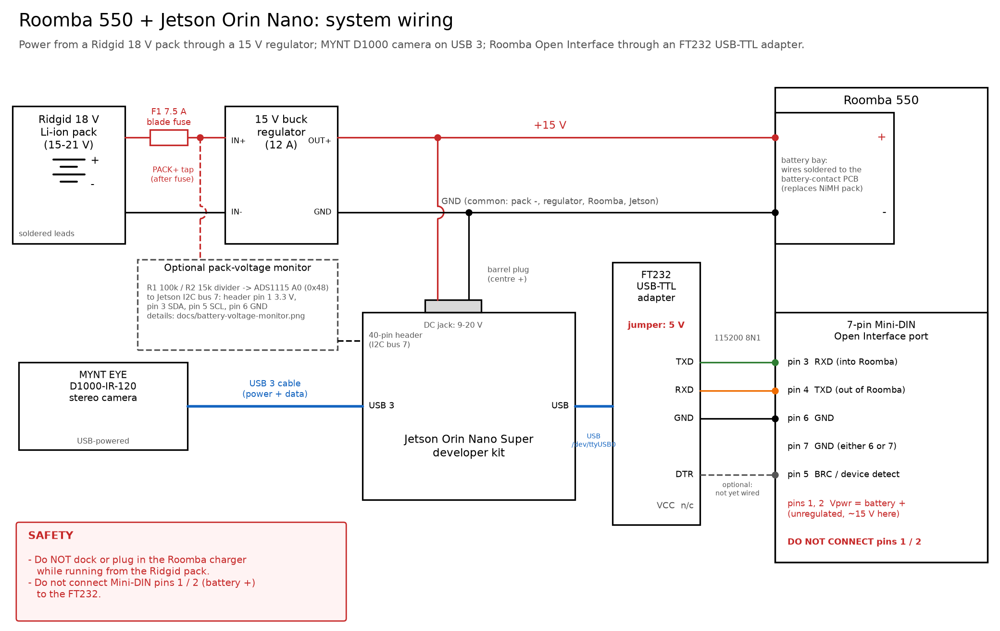

# roomba-jetson-stack

ROS 2 Jazzy stack that turns an old **iRobot Roomba 550** into a mapping, self-navigating robot.
A **Jetson Orin Nano Super** rides on a 3D-printed platform with a **MYNT EYE D1000** stereo camera
and drives the Roomba through its Open Interface serial port.

The serial driver lives in its own repository and is included here as a submodule:
[Brett-D/roomba-serial-ros2](https://github.com/Brett-D/roomba-serial-ros2). It has the Rust driver
`roomba_driver_rs`, which the robot runs, and the original Python `roomba_driver` (`rust_nodes:=false`).

## What's in here

| Path | Contents |
|---|---|
| `src/roomba_bringup` | Launch files (`robot.launch.py`, `vslam.launch.py`, `nav.launch.py`, `handheld_slam.launch.py`, `twin2d.launch.py`), Nav2 configs, robot driver config, digital-twin scenarios (`config/twin2d/`) |
| `src/roomba_perception` | VSLAM watchdog/odometry filter with wheel bridging, EKF input conditioning (`ekf_inputs`), floor obstacle detection, explorer, ignore zones, nav coach, person detector, IMU calibration |
| `src/roomba_rs` | Rust ports of the robot's ROS 2 nodes (rclrs): `floor_obstacles`, `ekf_inputs`, `vslam_watchdog`, `map_gap_filler`, `ignore_zones`, `web_server`, `set_password`, `explorer`, `nav_coach` and `person_detector` (TensorRT and OpenCV through a small C++ shim in `native/`) (same topics, services, parameters, files and output as the Python nodes at a fraction of the CPU; `vendor/` holds generated Rust bindings for the Isaac ROS VSLAM interfaces). `tf_buffer`/`tf_listener` give rclrs nodes a tf2-equivalent TF buffer (bit-identical lookups). `rust_nodes:=false` switches back to the Python nodes (and the Python Roomba driver). `twin2d` is the 2D digital twin (see [Digital twin (2D)](#digital-twin-2d)); its simulated Roomba uses the Open Interface code of the Rust driver's library (`roomba_driver_rs`, a cargo path dependency on the submodule); `nav2_guard` (Rust only) brings Nav2's servers up when the lifecycle manager's start-up hangs on a lost answer; `sound_events` (Rust only) plays [event sounds](#event-sounds) on the Roomba; `battery_learner` (Rust only) is the robot's battery gauge, learned from the pack swaps (see [Battery gauge](#battery-gauge)) |
| `src/roomba_web` | Web app on port 8080: live camera, map and depth views (side by side, or the three-view layout), robot status, drive pad, tap-to-go navigation, login (the page, and the Python server used with `rust_nodes:=false`) |
| `src/mynteye_d1000_driver` | ROS 2 node for the MYNT EYE D1000 stereo/depth/IMU camera |
| `src/basalt_vio_ros` | ROS 2 wrapper for Basalt visual-inertial odometry |
| `src/roomba-serial-ros2` | Roomba Open Interface driver (submodule): `roomba_driver_rs` (Rust, used with `rust_nodes:=true`), `roomba_driver` (Python), `roomba_msgs`, and in `tools/` the simulated Roomba (`fake_roomba.py`) and the driver A/B checks |
| `src/roomba_skills_msgs` | Interfaces of the learned navigation skills (`action/Unstuck`) |
| `twin/learned` | Learned navigation skills (trained in simulation; on by default on the robot since 2026-11-16, `unstuck_skill:=false goal_ranking:=rule` turns them off): Isaac Lab unstuck policy, learned frontier ranking for the explorer, their evaluation against the classical logic and in the 2D twin, and the Rust inference (`roomba_rs` feature `learned`, node `unstuck_skill`, explorer options `unstuck_skill` and `goal_ranking: learned`); see [docs/learned-skills.md](docs/learned-skills.md) |
| `scripts/` | `run_robot.sh`, `stop_slam.sh`, `graceful.py` (`ros2 launch` that SIGTERM / SIGINT stop cleanly), `install_control_page.sh` (the control page service), `record_run.sh` / `compare_pipelines.sh` (A vs B on a recorded drive), `run_twin2d.sh` (the 2D digital twin), mapping/replay helpers, setup scripts |
| `control/` | Control page (standalone Rust, no ROS libraries, always on, port 80): start / stop the robot, Roomba comms check, VACUUM ARMED, sound buttons, Jetson health, robot log, camera / map / depth, shut down; see [Control page](#control-page-phone-or-browser) |
| `tools/` | Probes and diagnostics (motion step test, costmap/obstacle probes, map render, TF/drift/CPU-GPU checks, comparison monitor/renderer, Python vs Rust A/B checks), `twin2d_world.py` / `twin2d_plan.py` / `twin2d_run.py` (digital twin floor plan from the map database or a vector plan, scenario runner), `sound_events_offline.py` (the event-sounds node against a fake driver), `battery_learner_replay.py` (the battery gauge through whole simulated discharges and swaps); `tools/oi_tests/` holds early serial/OI bench scripts |
| `docs/` | Wiring and power diagrams; [training.md](docs/training.md): everything that was trained in this project (Isaac Sim person / railing detector, unstuck skill, frontier ranking), with algorithms, code, results and status (simulation only, nothing learned is deployed); [learned-skills.md](docs/learned-skills.md): the two navigation skills in detail |
| `hardware/platform` | 3D-printed platform: STLs, fit tests and the Python generator |

## Data flow

```
MYNT D1000 ──> Basalt VIO ──> vslam_watchdog ──> odom ──> RTAB-Map (map) ──> Nav2 ──> collision monitor ──> /cmd_vel
                                  ▲                                                                         │
Roomba wheel odometry + gyro ─────┘                                              roomba_driver (serial) <───┘
```

TF: `map → odom → base_link → camera_link` (camera mount: x 0.135 m, z 0.12 m).

## Hardware

- Roomba 550 (R3 board), Open Interface at 115200 baud
- Jetson Orin Nano Super 8 GB, ROS 2 Jazzy
- MYNT EYE D1000 stereo camera (USB)
- FT232 USB-TTL adapter set to **5 V** on the Roomba mini-DIN (the Jetson header UART with a BSS138 shifter was unreliable)
- Power: an 18 V Li-ion tool pack (Ryobi, 5 cells, 4-bar fuel gauge) wired straight to the Roomba's battery
  contacts, so the Roomba's own voltage and current sensors measure the pack (see [Battery gauge](#battery-gauge));
  the Jetson runs from a separate pack. The wiring diagram below shows the earlier setup (one pack through a
  15 V regulator for both). See [`docs/battery-voltage-monitor.png`](docs/battery-voltage-monitor.png) for the ADS1115 pack-voltage monitor.
  **Do not dock or plug in the Roomba charger while running from the tool pack.**
- 3D-printed platform: STLs and generator in [`hardware/platform/`](hardware/platform/)

System wiring (power, camera and serial), [`docs/system-wiring.png`](docs/system-wiring.png):



## Build

```bash
git clone --recurse-submodules https://github.com/Brett-D/roomba-jetson-stack.git ~/roomba_ws
cd ~/roomba_ws
source /opt/ros/jazzy/setup.bash
rosdep install --from-paths src --ignore-src -y
# Rust toolchain for src/roomba_rs and roomba_driver_rs (cargo fetches rclrs; message crates come from /opt/ros)
curl --proto '=https' --tlsv1.2 -sSf https://sh.rustup.rs | sh -s -- -y --profile minimal
sudo apt install -y libclang-dev mold && source ~/.cargo/env   # mold: GNU ld takes 10+ min to link
# roomba_rs also needs JetPack's TensorRT, CUDA and OpenCV dev files (libnvinfer-dev, cuda-toolkit, libopencv-dev)
colcon build --symlink-install
```

Python vs Rust checks on a recorded drive: `tools/ab_floor_obstacles.sh` (side by side, frame by
frame, plus CPU; `tools/ab_floor_drops_offline.py` compares the drop-off detection bit for bit),
`tools/ab_ekf_offline.py` (same message sequence into both, every output compared)
and `tools/ab_ekf_inputs.sh` (CPU). For the watchdog, `tools/record_vio_replay.sh` first replays a
raw recording through the VIO and records its output; `tools/ab_watchdog_offline.py` then feeds that
to both watchdogs (TF, odometry, status, service calls and logs compared, optionally with injected
faults) and `tools/ab_watchdog.sh` measures CPU. `tools/ab_tf_buffer.py` compares the Rust TF buffer
with tf2 on recorded /tf. `tools/record_map_replay.sh` replays a raw recording through RTAB-Map and
records its grid and path; `tools/ab_map_gap_filler_offline.py` compares the filled grids cell for
cell and `tools/ab_ignore_zones_offline.py` the zone outputs (JSON, masks, markers, zones file) on
scripted and random commands, clicks and bump marks; `tools/ab_scene_filter.py` checks the zone/line
of sight helpers and `tools/ab_zones_gap_filler_cpu.sh` measures CPU and memory of both pairs.
The driver's checks live with it in `src/roomba-serial-ros2/tools/`: `fake_roomba.py` simulates the
Roomba on a pseudo-terminal (scripted sensors, bumps, cliffs, charging, bad checksums, stream
dropouts, sleep, reset); `ab_driver.sh` runs both drivers through the same scenario
(`ab_driver_harness.py`) and `ab_driver_compare.py` compares the serial bytes, topics,
service responses, logs and shutdown bytes (`SCENARIO=lightbump` times the light-bumper stops);
`ab_driver_cpu.sh` measures CPU. With the robot's parameters:
`CONFIG=src/roomba_bringup/config/roomba_driver_robot.yaml src/roomba-serial-ros2/tools/ab_driver.sh`.
`tools/ab_web.sh` runs both web servers side by side on scripted topics and compares every HTTP
response (all routes, methods and login states), websocket state, MJPEG frame and published command;
`tools/ab_web_images.py` checks the camera preview JPEGs and map PNGs against OpenCV byte for byte
and `tools/ab_web_cpu.sh` measures CPU and memory with a recorded drive and a browser-like client.
`tools/ab_explorer_live.sh` replays a raw recording through the whole stack including Nav2 (sim time,
no drivers), steers the explorer with commands and records costmaps, TF, sensors, Nav2 action traffic
and the nodes' outputs; `tools/ab_explorer_offline.py` drives both explorers with scripted houses
(doors, invisible railings, bumps, cliffs, low battery, TF loss, a scripted NavigateToPose server that
can also answer late or never, and parameter services) and that recording, comparing every goal, cancel,
status, mark and log line plus the frontier goals on every costmap (and checking that lost Nav2 answers
never stall exploring); `tools/ab_nav_coach_offline.py` does the same for nav_coach's
instructions and `tools/ab_explorer_cpu.sh` measures CPU and memory of both pairs.
`tools/ab_person_detector_offline.py` feeds both person detectors the same frames, TF, RTAB-Map grids
and scripted zones / toggles and compares YOLO input and output tensors, detections, distances, ignore
reasons, markers, annotated images and JPEGs; `tools/ab_person_detector_cpu.sh` measures CPU, memory
and latency at the camera rate.

## Run

```bash
~/roomba_ws/scripts/run_robot.sh            # reuse the saved map, or start one if none exists
~/roomba_ws/scripts/run_robot.sh mapping    # start a new map (old one backed up to ~/maps/backup)
~/roomba_ws/scripts/stop_slam.sh            # stop everything
kill $(cat ~/robot.pid)                     # or stop the launch itself (SIGTERM; SIGINT works too)
```

Then open `http://<jetson-ip>:8080` and wait for **Tracking OK**. Wake the Roomba first (press Clean) if its lights are off.
The log is `~/robot.log`. The run scripts start `ros2 launch` through `scripts/graceful.py`: started in the
background, plain `ros2 launch` ignores SIGINT and dies on SIGTERM, leaving every node running. Through it,
SIGTERM or SIGINT to the launch (`~/robot.pid`, or a service manager's stop) shuts everything down like Ctrl-C:
each node gets SIGINT, then if still running SIGTERM 5 s later and SIGKILL only 85 s after that
(`sigkill_timeout:=`), so RTAB-Map can finish writing its map database.
The web login password is generated on first run and stored in `~/.config/roomba_web/initial_password`;
change it with `ros2 run roomba_web set_password` (or `ros2 run roomba_rs set_password`; same file).

### Battery gauge

The Roomba runs straight off an 18 V tool pack (5 Li-ion cells, a 4-bar fuel gauge), so the charge figures
the Roomba reports are made up. `battery_learner` (`src/roomba_rs`, started by `robot.launch.py`;
`battery_learner:=true` is the default) learns the pack from the Roomba's own voltage and current readings
(`/roomba/sensors`) and publishes `/battery_state`, which the explorer (`low_battery_fraction`, 0.2) and the
web app read. With it, the driver's own estimate (the pack voltage on a stock Li-ion curve) moves to
`/roomba/battery_raw`; `battery_learner:=false` puts the driver's `/battery_state` back as before.

**Swap the pack when its gauge shows 1 bar, for a full one.** That is all the learner needs:

- **Swaps are detected.** With the pack out the Roomba has no power: its sensor data stops, then comes back
  at least 0.4 V higher (open-circuit voltage: the reading plus current × 0.2 Ω). That is a new pack, and it
  starts at 100 %. A pack that reads part-charged on the learned curve starts from its voltage instead. A gap
  without a jump (a driver restart, a stream stall) is the same pack. A swap while the Jetson was off is
  caught at start-up, against the voltage saved last time.
- **Coulomb counting.** The charge is 100 % minus the mAh drawn since the swap over the learned capacity.
- **Learning at each swap.** The pack that came out was at 1 bar, taken as `one_bar_fraction` (15 %), so a
  pack that went in full measured capacity = mAh used / 0.85. The estimates are averaged. The prior
  (`capacity_mah`, 2000) weighs 0.2 and a pack that started from its voltage 0.3. With 3 or more estimates,
  those more than 30 % from the median are rejected. The pack's voltage samples, labelled linearly in mAh
  between its two anchors (100 % and 15 %), are merged with earlier packs into a voltage → charge curve.
  The curve is fitted with isotonic regression (monotone) over the stock Li-ion curve, which is shifted
  onto the data and fills in where there is none.
- **Voltage.** The curve gives the charge where the counter has no anchor (first run, a part-charged
  pack). While the robot draws under 0.8 A, it pulls the count gently towards the curve: with a time
  constant of 2 h for a pack that went in full, and 20 min for one that started from its voltage.
- **First run.** The pack in the robot read 18.29 V with its gauge at 3 bars. 3 bars is 50-75 %, taken as
  62 % (`seed_voltage`, `seed_fraction`). The stock curve called that 18 %, so until the swaps teach the
  real curve, it is shifted by +1.03 V to pass through that point. This assumes the whole curve is off by
  the same voltage (the Roomba reading the pack low, or generous bars). The pack in the robot starts from
  its voltage on that curve, and the first swap at 1 bar starts the learning.

Settings are in `src/roomba_bringup/config/battery_learner_robot.yaml` (all parameters:
`src/roomba_rs/src/battery_learner.rs`, `Params`). `one_bar_fraction` is the charge at which you swap: if
you swap at a different point (e.g. 2 bars, 0.4), change it before that swap. The seed applies only when
there is no state file yet.

The control page's **new pack** button, or by hand:

```bash
ros2 service call /battery_learner/pack_swapped std_srvs/srv/Trigger   # a full pack is in now
```

It sets the pack in the robot to 100 %. Called within 10 min of a detected swap, it only confirms it (it
marks that pack full if its voltage made it start lower). Otherwise it starts a new pack but learns nothing
from the old one: without a detected swap, there is no telling that the old pack was at 1 bar.

Files, in `~/.local/state/roomba/`:

- `battery_learner.json` holds the pack in use (charge, mAh used, how its start is known, its discharge
  samples by voltage) and the last 60 packs (when and how each came out, mAh used, capacity estimate, its
  labelled curve points). It also holds the learned capacity and the curve offset. It is written atomically
  (a temporary file renamed over it) every 30 s, at each swap and at shutdown, so it survives restarts and
  reboots. Delete it to start over (the seed applies again).
- `battery_pack_NNNN.csv` logs each pack's discharge, a line every 10 s, for refitting the curve offline:
  `unix_time,pack,voltage_v,current_a,ocv_v,used_mah,soc,soc_voltage,anchor`. `soc` is the published charge;
  `soc_voltage` is the curve's.

Swaps, capacity estimates and the learned capacity are logged at INFO (`~/robot.log`).
`/battery_state` also carries `capacity` (learned Ah), `charge` and `serial_number` (`pack N`). Tests:
`cargo test --lib battery_learner` in `src/roomba_rs`; `python3 -m pytest src/roomba_bringup/test` (which nodes
`robot.launch.py` starts for each `driver` / `battery_learner` value); and `tools/battery_learner_replay.py`, which
runs the node in ROS domain 79 against a simulated pack through whole discharges, swaps, restarts and the service.

### Position markers

A map made in one lighting can stop matching in another: a saved map made in daylight matched 0 features
at night, so the robot started at the wrong spot. Printed ArUco markers fix that. RTAB-Map adds each marker
to the map the first time it sees one, and every later sighting fixes the robot's position, whatever the
lighting or clutter.

```bash
python tools/markers/make_markers.py --out markers.pdf    # IDs 1-3 (1 = HOME), 150 mm, one per Letter page
```

- Print at 100 % and check that the 100 mm bar measures 100 mm.
- The HOME marker (ID 1 by default, `--home_id`) marks the robot's home / start spot: the one that matters. Starting in view of it, the robot knows
  where it is from the first frame whatever the lighting. Optionally add one more in the most central open
  area of each floor for starts elsewhere or recovery mid-run; between markers the visual odometry keeps
  the position. Don't use ID 0: RTAB-Map ignores it (marker IDs must be > 0).
- Mount them flat on walls facing open floor, centre about 20 cm above the floor (the camera is at about
  15 cm), on matte paper. Put them up **before** mapping and never move them afterwards.
- Markers are on by default (`markers:=true`, `marker_length:=0.15` in metres, detected up to 3 m). Use
  `markers:=false` to turn them off. A different print size needs a matching `marker_length:=`.

### Event sounds

`sound_events` (`src/roomba_rs`, Rust; launched by `robot.launch.py` with either driver) plays songs on the
Roomba's beeper through the driver's `/roomba/define_song` service:

| Event | Song slot | Notes (MIDI) | Durations (1/64 s) |
|---|---|---|---|
| **hello**: the driver first reports Safe or Full mode after start-up (once; `HELO` on the display for 3 s too, see below) | 0 | 67 72 76 | 10 10 24 |
| **uh-oh**: the bumper is pressed (left or right, a new press; not the light bumpers), at most once per 4 s, never over a song that is playing | 1 | 76 76 69 | 12 6 28 |
| **done**: an exploration run finishes or gets back to its start point (once per run) | 2 | 72 76 79 84 rest 79 84 | 7 7 7 14 4 8 36 |

Each sound is a single `define_song` call with the full notes and `play: true`, so it doesn't matter
if something else (the web control page, a `ros2 service call`) has used the same slot meanwhile;
slots 3 and 4 are never touched. Nothing plays outside Safe/Full mode, and the node never changes the mode.
`HELO` is only shown when the driver reports `auto_reenter_mode: false` (as in `roomba_driver_robot.yaml`;
the node asks whenever the driver appears): with `true` the driver re-enters Safe mode for a display command
that arrives in Passive, and the robot can drop to Passive just before one arrives.

- **Mute** without restarting: `mkdir -p ~/.config/roomba && touch ~/.config/roomba/sound_muted`;
  unmute with `rm ~/.config/roomba/sound_muted`. The file is checked at each event (`HELO` still shows).
- **Off**: `run_robot.sh sounds:=false` (or `robot.launch.py sounds:=false`), or the node's parameter `enabled: false`.
- Parameters: `enabled` (true), `mute_file` (`~/.config/roomba/sound_muted`), `bump_interval_s` (4.0), `display_s` (3.0).
- The driver has no bump event topic: its bump stop sees every 15 ms frame, but other nodes only get the
  bumpers in the `/roomba/sensors` snapshots, published at `sensor_rate_hz` (5 Hz in `roomba_driver_robot.yaml`).
  A press shorter than ~0.2 s can go unheard; holding the bump flags until the next snapshot (or a bump event
  topic) in the driver would fix that. With `ignore_sensors: ['bump_right']` (this robot's stuck switch) only
  the left bumper counts.
- Without the robot: `ROS_DOMAIN_ID=77 tools/sound_events_offline.py` runs the node against a fake driver and
  checks which songs it asks for and when.

### Control page (phone or browser)

`control/` is a small always-on page for running the robot without SSH. It has no ROS dependency, starts at
boot and serves port 80. Install or update it once, as the robot's user:

```bash
~/roomba_ws/scripts/install_control_page.sh
```

This builds the release binary and installs it as `/usr/local/bin/roomba-control` with the systemd service
`roomba-control`. It also allows the user exactly one root command, `systemctl poweroff`
(`/etc/sudoers.d/roomba-control-poweroff`), and enables lingering for the user, so logging out of SSH can't
delete the running robot's shared memory.

Open `http://<jetson-host>.local/` (or `http://<jetson-ip>/`) and log in with the robot web app's password.
On a phone, "Add to Home Screen" adds it as an app.

- **ROBOT PWR** (toggle): up runs `scripts/run_robot.sh auto` (the saved map; the page has no way to start a new
  map). Down first switches the vacuum and brushes off (`roomba/cleaning_motors`, all off), then sends SIGTERM to
  the launch in `~/robot.pid` (a clean Ctrl-C-like stop: RTAB-Map saves the map, and the amber SAVING MAP light
  shows it). If the launch is still running after 100 s (graceful.py's own SIGTERM and SIGKILL escalation ends by
  90 s), it runs `stop_slam.sh`. A launch without a PID file is stopped with `stop_slam.sh`. The lever moves only
  when the Jetson reports the new state.
- **COMMS CHECK** (push-button) tests the Jetson ↔ Roomba serial link:
  - While the robot runs, the driver owns the port, so the page asks the driver over ROS (`roomba/mode`,
    `battery_state`).
  - Otherwise it opens the port named in `roomba_driver_robot.yaml` and sends only Start (128, Passive mode) and
    one sensor query (142, packet 3: voltage and current). It never sends Safe/Full or any drive command.
  - The result reads "OK: voltage …", "No reply: Roomba asleep, press Clean until its lights come on", or
    "Port missing: check the USB-serial cable".
- **VACUUM ARMED**: lift the yellow guard and flip the switch up to run the vacuum, main brush and side brush
  (`roomba/cleaning_motors`); the ARMED sound plays. Flip it down, or close the guard, to switch them off.
  - It can be armed only while the robot runs and the OI mode is Safe or Full; otherwise the page says why.
  - The driver doesn't report the motors, so the switch shows what the page commanded. It disarms by itself
    when the robot stack stops, the OI mode leaves Safe / Full (the Roomba stops its motors then) or a cliff or
    wheel drop is reported (it also sends all-off then, for Full mode).
- **SOUND** panel:
  - AUTO SOUND (toggle): MUTE creates `~/.config/roomba/sound_muted`, which keeps the `sound_events` node quiet.
  - Push-buttons OW, ARMED, CHATTER, HELLO and UH-OH: each press defines its song and plays it
    (`roomba/define_song` with play: songs 2, 3, 4, 0 and 1). They also play while muted, and only while the
    robot runs in Safe or Full mode. One press a second.
- **JETSON SHUTDOWN**: lift the red guard, flip the switch, then confirm. The robot stops first, exactly as above,
  then the Jetson powers off. When the page says **SAFE TO REMOVE POWER**, you can unplug it.
- **Annunciators**: STACK, ROOMBA LINK (connected / responding / not responding), OI MODE, VACUUM, CAMERA, TEMP,
  WIFI and DISK, in green, amber or red. The last lines of `~/robot.log` show "Tracking OK" and errors.
- **Camera · map · depth**: while the robot runs, the robot web app's three-view layout (port 8080 on the same
  host) is shown in a frame, with an "Open robot page" link.

The page talks to ROS only through the `ros2` CLI (`ros2 service call`, `ros2 topic pub --once`, and
`ros2 topic echo` of `roomba/mode`, plus `roomba/sensors` while the vacuum is armed). A sound or a vacuum switch
takes a few seconds while the CLI starts.

Power-on is physical: apply power, and the Jetson boots and brings the page back by itself. The page logs to the
journal (`journalctl -u roomba-control`). `roomba-control --check-comms` runs the comms check from a shell.
Tests with stand-ins (no robot, serial port or power-off):
- `control/tests/e2e/run.sh` tests the whole page with stand-in scripts.
- `control/tests/e2e/ros_controls.sh` tests the sounds and the vacuum against a fake driver in ROS domain 78.

### Robot web app views

On a wide screen the robot page (`http://<jetson-host>.local:8080/`) shows the camera, the map and the depth
camera side by side. On a phone, tabs pick one of them, or **All 3** stacks them. **▦ 3-view** (or
`?layout=mfd`) shows only the three views, without their controls: this is what the control page frames.
In the three-view, drag the dividers between the views to resize them, and click a view's title to collapse
or expand it (a collapsed camera or depth view stops its stream). **↺ Reset views** restores equal sizes.
- **Depth** is `/depth.mjpg`: `/camera/depth/image_rect_raw` in turbo colours, red at 0.2 m to blue at 4 m and
  black where there is no depth (parameters `depth_min_m`, `depth_max_m`).
  - It runs at up to `depth_fps` (5) frames a second.
  - The web server subscribes to the depth image only while someone is watching.
  - It is in the Rust web server only: with `rust_nodes:=false`, the page says the depth view needs it.
- **Map**: as before, plus the explorer's current goal and home.

### Pipelines A (default) and B (GPU)

Extra arguments to `run_robot.sh` / `robot.launch.py` pick the odometry, the fusion and the costmap obstacles:

| Argument | Default (A) | GPU pipeline (B) |
|---|---|---|
| `odometry:=` | `basalt` (CPU VIO) | `cuvslam` (Isaac ROS Visual SLAM) |
| `fusion:=` | `watchdog` (vslam_watchdog publishes `odom → base_link`) | `ekf` (robot_localization: wheels + calibrated gyro + VIO, `config/ekf_robot.yaml`) |
| `obstacles:=` | `floor` (floor_obstacles + voxel layer, `nav2_robot.yaml`) | `nvblox` (GPU TSDF/ESDF, `config/nvblox_robot.yaml`, `nav2_robot_nvblox.yaml`) |

```bash
~/roomba_ws/scripts/run_robot.sh mapping                                                   # A
~/roomba_ws/scripts/run_robot.sh mapping odometry:=cuvslam fusion:=ekf obstacles:=nvblox    # B
```

The three choices are independent. With `fusion:=ekf` the watchdog still checks the VIO, resets it and
publishes `/vslam_filter/status`. The collision monitor always uses floor_obstacles.

### Recording a drive and comparing the pipelines

```bash
~/roomba_ws/scripts/record_run.sh [--duration S] [--zstd] [--name X]   # with the robot running; Ctrl-C stops
~/roomba_ws/scripts/compare_pipelines.sh ~/bags/robot_<stamp> [--background] [--rate 0.5] [--only A|B]
```

`record_run.sh` records only the raw camera, IMU and Roomba topics plus `/tf_static` (no odometry/map TF) to
`~/bags/robot_<stamp>` (mcap, about 1.2 GB/min uncompressed). `compare_pipelines.sh` replays it through A and B
(sim time, camera and Roomba drivers off), each into its own RTAB-Map database, and writes metrics (tracking losses,
loop closures, map area, end-vs-start pose, CPU/GPU), a side-by-side map image and an overlay to `/data/maps/compare/`.

## Digital twin (2D)

`twin2d` (`src/roomba_rs`, launch `twin2d.launch.py`, script `scripts/run_twin2d.sh`) runs the robot's
real navigation stack on a simulated Roomba in a 2D model of the house, on the Jetson, headless, so
navigation and explorer problems can be reproduced, measured and used as regression tests.

**What is real and what is simulated.** Real (the same binaries and configs as on the robot,
`rust_nodes:=true`): `roomba_driver` (on a pty instead of the serial adapter, through a generated
params file in the run directory), the camera mount TF, `imu_filter_madgwick`, `ignore_zones`,
`nav.launch.py` (floor_obstacles, map_gap_filler, Nav2 with `nav2_robot.yaml`, nav_coach, explorer)
and the web app. The twin node replaces the hardware, the VIO/watchdog and RTAB-Map:

- *World*: the floor plan is the 2D grid of the saved RTAB-Map database (map frame, 5 cm cells),
  extracted with `tools/twin2d_world.py` (`rtabmap-export --map --opt 2` on a copy, then cleaned
  conservatively: 1-2 cell free "spikes" traced through gaps removed, small enclosed unknown holes
  filled). Every cell that isn't free is a full-height wall. Scenario files add doors (open/close
  at given times), railings (invisible or sparse to the depth camera, seen by the bumpers and light
  bumpers), obstacles with a height range (low thresholds, table tops the robot drives under),
  people walking paths, cliffs (stairs), the dock, battery and tracking-loss events.
  A vector floor plan can stand in for the grid: `tools/twin2d_plan.py --plan floorplan.json` (walls,
  doors, doorways, rooms, stair openings, railings in the map frame; the reader accepts the usual
  layouts) rasterises it onto the same cells and writes a `twin_overlay` next to the map YAML with
  the plan's doors (closable; scenario doors given by name only, e.g.
  `doors: [{name: kitchen, events: [...]}]`, are the plan's), stair openings as cliffs and railings
  the depth camera can't see. Run it with `world:=/data/twin/twin2d/world_plan/plan.yaml`; coverage
  is then measured against the whole floor, including rooms the robot never mapped.
- *Roomba*: differential drive from the wheel speeds the Open Interface was told (acceleration
  limit, optional turn scrub), collisions (it stops at what it hits, bumper pressed), bumper switches,
  the six light bumpers (IR ray casts; this unit's front-left is the sensitive one), wall and cliff
  sensors, falling down stairs, and the Ridgid pack's voltage under load. Its Open Interface on the
  pty behaves like `fake_roomba.py` and the robot: Off/Passive/Safe/Full (Safe drops to Passive
  on a cliff or wheel drop), streams in both driver layouts every 15 ms, queries, pause/resume, reset.
- *Camera*: 16UC1 depth registered to the left camera with the real intrinsics (640x360, 15 Hz,
  0.3-7 m, optional noise, dropout and the real camera's short scale), 2.5D ray casting against walls,
  bodies with heights, floor and ceiling (it looks down into stairwells); the camera driver's static
  TF; a 200 Hz IMU (gravity, yaw rate, bias, noise) in `camera_imu_frame`; a grey preview image.
- *Localisation*: `map -> odom -> base_link` from the ground truth (optionally drifting odometry that
  RTAB-Map's map -> odom corrects every N s), `/odom`, `/vslam_filter/status`, `/visual_slam/status`.
- *Mapping*: `/rtabmap/map` (latched) and `/rtabmap/mapPath` built the way RTAB-Map builds them on the
  robot: a node per second when the robot moved, each from the decimated depth cloud (2.5 m range,
  ground under 6 cm, obstacles to 1 m, noise filter, ray tracing), merged with RTAB-Map's hit/miss
  log-odds and clamping, the square under the robot's footprint reset to free, as
  `rtabmap/core/global_map/OccupancyGrid.cpp` does. As on the robot, a cell seen occupied in many
  nodes (a door that was closed for a while) needs ~18 later nodes seeing through it before the map
  shows it free again. It starts unknown (or `initial_map: known`).

Real time only, by design. The whole stack in the twin uses about 1.2 of the Jetson's 6 cores
(twin2d itself about 0.2: 200 Hz physics and IMU, the 15 ms OI stream, depth frames rendered in
5-9 ms at 15 Hz), so the CPU would allow roughly 3-4x. But the real nodes keep wall-clock time: the
driver's safety logic, bump reflex and serial stream (`mono()`), floor_obstacles' 6 Hz frame limit
(`Instant`), nav_coach and the web app (the explorer's timeouts follow the node clock, so they hold
under a slower `/clock`, e.g. Isaac).
On an accelerated `/clock` the driver would have to be replaced by an emulation and floor_obstacles
would see a third of the frames: the timing being tested would no longer be the robot's.

**Run it.**

```bash
tools/twin2d_world.py                         # once: /data/twin/twin2d/world/house.{pgm,yaml} from the map DB copy
scripts/run_twin2d.sh scenario:=src/roomba_bringup/config/twin2d/explore_from_dock.yaml \
                      out_dir:=/data/twin/twin2d/runs/try1          # foreground, ends by itself
scripts/run_twin2d.sh exit_on_finish:=false foxglove:=true          # keep it running to watch / drive
tools/twin2d_run.py explore_from_dock door_closes stairs --seeds 1,2   # batch, summary table
tools/twin2d_run.py --jobs 3 --seeds 1,2 explore_from_dock stairs     # 3 at a time, ROS domains 71-73
```

`ROS_DOMAIN_ID` defaults to 68 and discovery stays on the machine. Parallel runs (`--jobs N`) each get
their own ROS domain (`--domains`, default 71...), pty, out_dir and web / Foxglove ports
(18100 / 18800 + domain); `--watch` keeps the first slot on 18097 / 18765 with Foxglove and
`--now-file` records which run it is on, `--web-auth` gives every run the same web password (an
`auth.json` made by `set_password` under a scratch HOME), `--ws` runs another workspace's build (a
before/after with the same scenarios). The twin also runs in WSL on the PC (`docs/pc-wsl.md`; 8
stacks at a time comfortably). Watch it in the web app at
`http://<jetson>:18097` (password in `<out_dir>/home/.config/roomba_web/initial_password`; the real
`~/.config/roomba_web` is never touched) or Foxglove (`foxglove:=true`, `ws://<jetson>:18765`:
`/twin/world`, `/twin/ground_truth`, `/twin/state`, `/twin/events`, `/rtabmap/map`, costmaps, ...).
To see how the explorer decides where to go, import the Foxglove layout
`src/roomba_bringup/config/foxglove/explorer_debug.json` (twin, or the robot's bridge on port 8765):
map, costmaps and keep-out mask, footprint, `/plan`, `/explorer/markers` (frontier groups, the spots
it considered with distance and score or why it skipped them, the chosen goal with an arrow from
where it was chosen, spots it can only look from, failed and visited spots, keep-out marks it sent,
home; built only while someone subscribes), obstacle points, the depth image and the explorer status.
The twin starts the explorer itself (`explorer.autostart_s`) and plays the operator: when the robot
leaves Safe mode (cliff) and the explorer stops, it carries the robot back from the edge, re-enables
driving and restarts the explorer (`operator.delay_s`, `max_interventions`).

**Scenarios** (`src/roomba_bringup/config/twin2d/*.yaml`: explore_from_dock, door_closes,
door_reopens, invisible_railing, sparse_railing, nose_to_wall, low_battery, person_walking, stairs,
furniture, people_bump (people walk into the robot), ring_of_marks (phantom bumps all around it at the
dock), plan_stairwell (the floor-plan world with its stair opening as a drop-off); every key is
optional, unknown keys are errors; see `src/roomba_rs/src/twin/scenario.rs` for all of them):

```yaml
name: door_closes
seed: 1                        # noise, sparse posts; runs are repeatable apart from the real nodes' timing
duration_s: 1800               # simulated seconds before the run ends (if the explorer isn't done)
start: {x: 0.0, y: 0.0, yaw_deg: 0}   # map frame
dock: true                     # a 0.32 x 0.15 m box behind the start pose
initial_map: unknown           # or known
explorer: {autostart_s: 15}    # negative: don't start it (drive from the web app)
operator: {enabled: true, delay_s: 10, max_interventions: 3}
battery: {soc: 0.95, capacity_ah: 4.0, drain_scale: 1}
robot: {turn_efficiency: 1.0, stuck_bump_right: false}
sensors: {depth_noise_a: 0.002, depth_noise_b: 0.003, depth_dropout: 0, depth_scale: 1.0,
          person_rate_hz: 4, person_recall: 0.8, person_range_m: 5}   # simulated person detections
odometry: {scale_error: 0, yaw_drift_deg_per_m: 0, correction_period_s: 1}
doors:     [{name: d, segment: [[-1.6, -1.2], [-0.75, -1.2]], events: [{t: 60, state: closed}, {t: 420, state: open}]}]
railings:  [{name: r, points: [[1.2, 1.3], [4.4, 1.3]], depth: none}]        # none | sparse | solid
obstacles: [{name: o, polygon: [[...]], zmin: 0.4, zmax: 0.45, depth: solid}]  # or circle: [x, y, r], segment
people:    [{name: p, path: [[1.8, -0.35], [1.8, 2.4]], speed_mps: 0.7, from_s: 18, until_s: 618,
             walks_into_robot: false}]   # true: doesn't wait for the robot, bumps into it
cliffs:    [{name: stairs, polygon: [[2.0, 2.3], [3.4, 2.3], [3.4, 2.95], [2.0, 2.95]], drop_m: 1.0}]  # how far down the camera sees
events:    [{t: 240, battery_soc: 0.17}, {t: 300, tracking_lost_s: 10}, {t: 400, explorer: stop},
            {t: 5, bump: left}]          # a 0.3 s bumper press with nothing there (left | right | both)
```

People in view are reported on `/perception/person_detector/detections_3d` (as the person detector
does, at `person_rate_hz`, each seen with probability `person_recall` within `person_range_m`;
not through walls, closed doors, furniture or other people in the line of sight).

**Outputs** (in `out_dir`): `result.json` (outcome: explored / timeout / fell / stopped / ...,
coverage of the true free floor and of the places the robot fits, over time; distance; every bump
and contact with what was hit and where; stuck episodes - no 0.25 m of progress for 30 s while a Nav2
goal is active - and idle waits (the explorer "exploring" without a goal); Nav2 goals sent / succeeded
/ aborted / canceled and "false successes" (success reported more than 0.5 m from the goal); Nav2
recoveries; driver bump stops and back-ups; collision monitor stops; explorer status, goals skipped,
bump marks, bumps it left unmarked because a person was in front and marks it removed when they boxed
it in; `railing`: the closest the robot's edge came to a railing and the seconds it spent within
0.10 m of one; operator interventions; battery; and `frontiers_at_end`: every frontier left on Nav2's
global costmap with the explorer's verdict on it, judged with its own functions - too small,
usable, no clear spot, or not reachable with the cheapest crossing cost into it), `trajectory.png`
(map against the true floor plan: mapped free white, true floor never mapped pink, path blue to
green, bumps orange crosses, stuck episodes magenta circles, doors brown, railings purple; the legend
is in `result.json`), `costmap_end.png` (the final global costmap with the frontiers coloured by
verdict: usable green, too small orange, unreachable red, no clear spot magenta), `timeline.csv`,
`events.jsonl` (doors, bumps, explorer messages, Nav2 goals, driver and Nav2 warnings), the
generated driver params, the zones file. `tools/twin2d_run.py` adds `cpu.json` (CPU per process)
per run and `summary.md` / `summary.json`. A/B experiments with explorer parameters, without editing
the robot's config: `explorer_params:='{passable_cost_max: 252}'` (twin2d.launch.py, or
`tools/twin2d_run.py --launch-args "explorer_params:='{passable_cost_max: 252}'"`).

## Known quirks

- Sending Start (128) drops the Roomba from Safe to Passive; the driver only re-sends it after a repeated stream stall.
- This robot's right bumper switch is stuck; `roomba_driver_robot.yaml` ignores `bump_right` and stops on the light bumper instead.
- Nav2 Jazzy velocity polygons must cover every velocity range, so the collision monitor has small `turn` and `reverse` sub-polygons.
- Wheel odometry over-reports in-place turns by about 40% on carpet; the watchdog trusts gyro and VIO for rotation.

## License

Apache-2.0, except `src/basalt_vio_ros`, which is BSD-3-Clause like Basalt itself.
