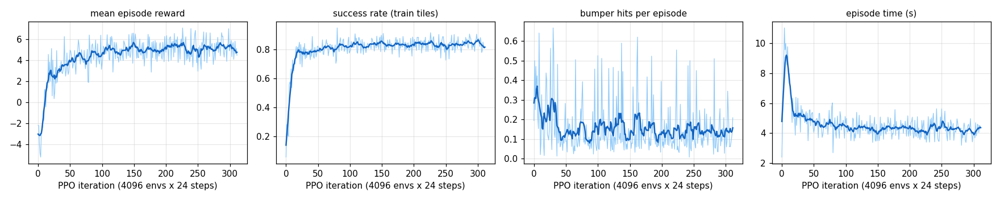
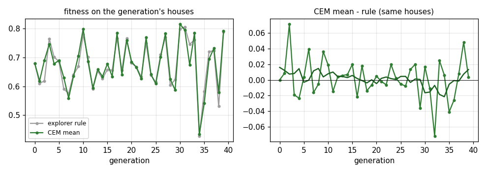
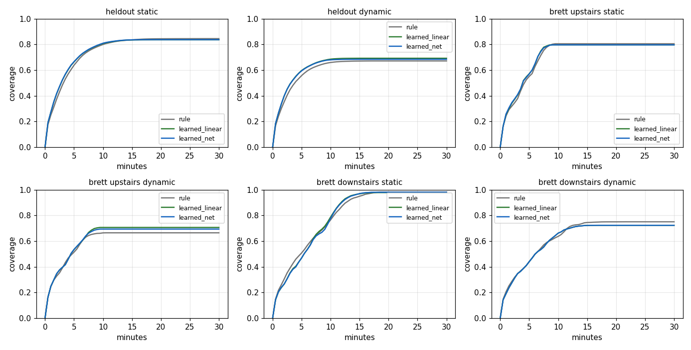

# Learned navigation skills (phase 1: simulation)

Two learned skills for the explorer's weakest moments, trained and evaluated in simulation against
the classical logic, with the robot-side inference prepared but **not deployed** (both are off by default:
`-DLEARNED_SKILLS=ON` builds them, the launch arguments `unstuck_skill:=true` and
`goal_ranking:=learned` turn them on; the explorer's default behaviour is unchanged):

1. **Unstuck**: a small policy that drives the robot out of a stuck situation (nose to a wall inside
   the camera's 0.3 m blind zone, wedged in a corner or between chair legs, under an overhang at camera
   height, at an invisible railing, inside a ring of bump keep-out marks...). Isaac Lab, PPO.
2. **Smarter exploration**: learned re-ranking of the explorer's own frontier candidates (it never adds
   a goal, so every explorer rule still applies). Fast GPU 2D environment in PyTorch.

Everything lives in `twin/learned/` (training, evaluation) and `src/roomba_rs/src/learned/` (Rust
inference), plus the `roomba_skills_msgs` interface package and the `unstuck_skill` node. For an
overview of everything trained in this project (including the Isaac Sim person / railing detector),
with algorithms, budgets and status side by side, see [training.md](training.md).

| | |
|---|---|
| Isaac Lab | **3.0.0** (release/3.0.0, Oct 2026; the Isaac Lab release for Isaac Sim 6.2), source checkout `E:\twin\learned\IsaacLab`, venv `E:\twin\isaaclab-env` (Python 3.12, uv, caches on `E:\twin\cache`) |
| physics | **OVPhysX 0.6.4** (PhysX as a standalone library, *kit-less*): the same PhysX solver as Isaac Sim, without starting Kit. Isaac Sim 6.2 itself was not reinstalled (it is in use by the Isaac Sim twin) |
| PyTorch / Warp / RSL-RL | 2.11.0+cu130 / 1.17.0 / rsl-rl-lib 5.5.1 |
| disk | ~4.7 GB venv (hard links into the shared uv cache) + ~0.3 GB data/runs |
| stock check | `isaaclab train --rl_library rsl_rl --task Isaac-Cartpole-Direct physics=ovphysx`, 1024 envs, headless: reward 0.1 -> 4.9, episode length 300/300 in 60 iterations (2 min) |

Install (PowerShell, as used here):

```powershell
. twin\learned\env.ps1             # uv on PATH, caches in E:\twin\cache, UV_PROJECT_ENVIRONMENT=E:\twin\isaaclab-env, TEMP on E:
git clone --depth 1 --branch release/3.0.0 https://github.com/isaac-sim/IsaacLab.git E:\twin\learned\IsaacLab
cd E:\twin\learned\IsaacLab; uv sync --locked --extra ovphysx
uv pip install --python E:\twin\isaaclab-env\Scripts\python.exe mapbox-earcut   # trimesh polygon extrusion (house tiles)
```

## 1. Unstuck skill

### Environment (`twin/learned/unstuck/`)

A direct-workflow Isaac Lab env (`unstuck_env.py`, `Roomba-Unstuck-v0`), 4096 Roombas in parallel at
50 Hz physics / 10 Hz control (median ~20k env steps/s on the 5090 while sharing it with other jobs).

- **Robot** (`robot_usd.py`, written with pxr so it loads kit-less): the dimensions of
  `twin/isaac/robot/roomba550_d1000.urdf`. Body shell (r 0.17 m, the bumper), D1000 housing and lid
  payload on a separate body (hitting an overhang with them does *not* press the bumper, as on the
  robot), front caster on its own body, cylinder wheels (r 0.036 m, base 0.235 m) on velocity drives.
  Measured in sim: 0.235 m/s for a 0.25 command, 0.6 rad/s for 0.8 (scrub; the real robot turns 40-60 %
  on carpet); thresholds of 2 cm or more stop it (drivable rugs are visual only, see section 5).
- **Stuck tiles** (`scenarios.py`, `world.py`): 4 x 4 m tiles, each one stuck situation, generated
  procedurally and merged into one static mesh (collision) plus two ray-cast meshes (what the depth
  camera sees, what the light bumpers see): `nose_wall`, `corner`, `chair_legs` (table + chairs, thin
  legs sometimes invisible to depth), `narrow_gap`, `threshold` (2-3.5 cm, in a doorway), `railing`
  (posts invisible to depth, often a stair void behind, often old bump marks), `overhang` (underside
  0.095-0.145 m: body fits, camera / payload wedge), `door_leaf`, `bump_ring` (keep-out strips around
  the robot, some real invisible posts), `cliff_edge`, `clutter`. Training set 1536 tiles (seed 1),
  held-out set 440 tiles (seed 1001). `show_tiles.py` draws them.
- **What the stack does around the skill is emulated**: velocity smoother limits (0.25 / -0.15 m/s,
  0.8 rad/s, accel 0.35 / 1.5), the collision monitor's velocity polygons (forward StopZone x 0.17-0.35 m
  and SlowdownZone, fed by the depth obstacle points *and floor_obstacles' blind wall when the camera
  sees nothing*), and the driver's bump stop + back-up reflex (8 cm back, 0.4 rad away, rate limited)
  and front-left light-bumper stop. Cliffs end the episode as a failure (on the robot Safe mode stops).
- **Observation** = what the robot has at runtime (layout in `src/roomba_rs/src/learned/unstuck.rs`):
  a 24 x 24 x 0.1 m robot-frame patch of lethal local-costmap cells (spatio-temporal marks from a
  depth ray fan 0.3-2.0 m with 5 s decay and frustum clearing, like STVL; explorer bump keep-out strips;
  the rolling window +-1.5 m), 6 light bumpers (proximity), bumper switches, wheel-encoder v / w (slip
  shows up as a mismatch with the motion), IMU yaw rate, previous action, motion over the last 1 s,
  goal distance / bearing, time used. Action (v, w) in the real limits at 10 Hz.
- **Domain randomisation**: wheel gains (0.85-1.05 each), motor torque (0.5-1.0 N m), one step of
  command latency (50 %), light-bumper gains and noise, the stuck right bumper switch ignored (50 %),
  gyro bias / noise, 5 % depth dropout, 1 % costmap cell flips, start pose jitter.
- **Reward**: +10 on success (ground-truth clearance >= 0.30 m to anything the robot can hit, incl.
  holes), progress toward the goal, clearance gain, -1 per new bump, -0.1 per step in contact, -0.5 per
  camera / payload contact, -10 cliff / fall, -0.05 per step, a jerk penalty. 15 s episodes.

### Training

```powershell
cd twin\learned\unstuck
python robot_usd.py; python make_tiles.py; python house_tiles.py          # assets + tile sets (data/, not in git)
python train_unstuck.py --num_envs 4096 --iters 600 --run main            # E:\twin\learned\runs\unstuck\main
python ..\plot_curves.py --unstuck E:\twin\learned\runs\unstuck\main --out ..\..\docs\learned-skills
```

PPO (RSL-RL 5.5), actor / critic MLP 256-128-64 ELU with observation normalisation, 4096 envs x 24
steps per iteration (learning rate 5e-4 with the adaptive KL schedule, gamma 0.98, lambda 0.95, clip
0.2, entropy 0.003, 5 epochs x 4 mini-batches, seed 7). Configured for 600 iterations, stopped by hand
after 312 (30.7 M env steps, 39 min; it shared the GPU with the Isaac Sim twin and the exploration
runs): the training success rate had been flat (mean 0.84) since iteration ~150. `model_300.pt` is the
exported checkpoint.



### Evaluation vs the classical recovery

`evaluate_unstuck.py` runs one deterministic episode per tile (no randomisation, the right bumper
ignored as on the robot) with either the policy or **`baseline.py`, the classical recovery in the same
env**: Nav2's planner + RPP emulated on the same costmap patch (free heading toward the goal, rotate to
heading > 0.6 rad, progress checker) and the BT's RoundRobin recoveries (Spin +1.57, Spin -3.14, BackUp
0.10 m at 0.05 m/s, clear costmap + wait 2 s), with the same smoother, collision monitor and driver
reflexes underneath. Success = ground-truth clearance >= 0.30 m within 15 s.

Held-out procedural tiles (440):

| | classical | learned |
|---|---|---|
| success | 0.28 | **0.86** |
| median time to free (successes) | 6.9 s | **1.5 s** |
| bumper hits / episode | 0.29 | **0.17** |
| camera / payload contacts / episode | 0.57 | **0.23** |
| cliff / fall | 0.01 | **0.00** |

| scenario (n) | classical | learned | | scenario (n) | classical | learned |
|---|---|---|---|---|---|---|
| nose_wall (35) | 0.49 | 1.00 | | overhang (45) | 0.16 (13 % cliff/fall) | 0.71 (2 %) |
| corner (47) | 0.04 | 1.00 | | railing (48) | 0.62 | 1.00 |
| chair_legs (36) | 0.31 | 0.67 | | door_leaf (41) | 0.05 | 1.00 |
| narrow_gap (54) | 0.15 | 0.93 | | bump_ring (39) | 0.26 | 0.90 |
| threshold (38) | 0.39 | 1.00 | | cliff_edge (18) | 0.72 | 1.00 |
| clutter (39) | 0.15 | 0.31 | | | | |

Stuck situations cut from **the real house's floor plans** (remodelled twin) (`house_tiles.py`: both floors' vector plans,
117 tiles: nose to walls, room corners, furniture and bathroom fixtures, door jambs, the stair / well
railings with the stair void behind them):

| | classical | learned |
|---|---|---|
| success | 0.30 | **0.85** |
| median time to free | 7.7 s | **1.1 s** |
| bumper hits / episode | 0.15 | **0.01** |
| cliff / fall | 0.03 (27 % at the railings) | **0.00** |
| success by kind: wall / corner / furniture / door / railing | 0.22 / 0.25 / 0.29 / 0.39 / 0.45 | 0.85 / 0.82 / 0.79 / 0.96 / 0.91 |

Reading the numbers: the policy mostly learned *the right first move* - back out (or turn first when
backing would hit something it remembers or feels), using the light bumpers and the remembered
costmap rather than the blind camera - and it does it immediately, while the classical controller first
tries to follow the plan, waits for the progress checker, then spins (which the collision monitor and
the walls often make useless) and backs up only 10 cm. Neither makes much progress toward the goal
within the episode (+0.01 m learned, +0.06 m classical): the skill's job is to hand a free robot back to
Nav2. Remaining failures: dense clutter (0.31) and chair legs (0.67), where the way out is a narrow
gap that must be found by feel.

## 2. Exploration: learned frontier selection

### Why a 2D PyTorch environment (not Isaac Lab)

The skill only decides *which* frontier to drive to next; Nav2 does the driving. One decision is
"follow the planned path to that frontier while the camera maps": ray casting, distance fields and
connected components on a grid, which vectorise perfectly as `[N, H, W]` tensors over hundreds of
houses on the GPU (~400-1000 decisions/s, CUDA-graph relaxations for the Dijkstra fields, a Warp
kernel for path tracing). Rigid-body simulation of every wheel turn would add nothing to this decision
and cost orders of magnitude more time.

### Environment (`twin/learned/explore/`)

- **Layouts** (`layouts.py`, `make_layouts.py`): 2000 procedural houses for training (rectangular or
  L-shaped outline, rooms by recursive splitting, hallways, doors 0.8-1.0 m that can be closed,
  open-plan openings, furniture against walls, tables / chairs as legs only), 200 held-out houses (other
  seed), and **the real house's two floors** rasterised from `floorplan.json` / `floorplan_floor1.json` (walls,
  doors, furniture, fixtures, stair void, railings; balconies excluded; glass doors closed), never used
  for training. 0.1 m cells.
- **Sensing**: 48-ray 85 deg depth FOV, 0.3 m blind zone, 3 m range (2.5-3.5 m in training), the robot's
  footprint cleared like RTAB-Map does; along every path every 0.3 m, plus the turn on the spot at the
  start and the end (the explorer's goal yaw looks at the frontier).
- **Explorer rules, reproduced from `explorer.rs`**: Nav2-like costmap from the belief (inscribed
  0.17 m, inflation 0.3 m -> `free_cost_max 40`, `passable_cost_max 98`, `goal_cost_max 15`), frontiers
  (free cells next to unknown, 8-connected groups >= 0.5 m), reachability from the robot's seed cell,
  goal cell = nearest clear cell within 0.8 m of the frontier centre, 0.3 m standoff from unknown,
  blacklist 0.75 m / visited 0.6 m / minimum distance 0.4 m, score `d - 0.01 x cells`, retry failed areas
  before finishing, finish confirm, return home. **Baseline = the rule's choice.**
- **Driving**: Dijkstra path on the costmap (cells in the inflation zone cost 2x), 0.2 m/s average,
  0.5 rad/s turning, 3 s per goal; closed doors and people on the path stop the robot 0.3 m before them
  (goal failed: blacklisted, +15 s); doors open / close randomly (~1 per 20 min each), up to 2 people
  move around, battery 30-100 % (90 min full, home at 20 %), 30 min limit.
- **Policy input** (`env2d.observe`, mirrored by `src/roomba_rs/src/learned/explore.rs`): a 64 x 64
  robot-centred crop of the map at 0.2 m (free / occupied / unknown fractions), 10 global values
  (battery, time, heading, home offset, failures...), 16 features for each of the top 16 candidates in
  rule order (offset, distance, Dijkstra path cost, frontier length, unknown area around it, turn,
  distance to home, failures / visits nearby, rule score, rank...).

### Training

```powershell
cd twin\learned\explore
python make_layouts.py
python train_cem.py --pop 24 --houses 12 --gens 40 --run main            # linear scorer, E:\twin\learned\runs\explore_cem\main
python train_explore.py --theta E:\twin\learned\runs\explore_cem\main\theta_mu.npy --ent 0.003 --lr 1e-4 --updates 120 --run ppo_from_cem
python export_ranker.py --ckpt E:\twin\learned\runs\explore\ppo_from_cem\ranker_final.pt
```

- **PPO from scratch on the full ranker** (CNN over the map + candidate MLP, rule prior, 256 houses in
  parallel, default lr 3e-4 / entropy 0.01, 81 updates / 304k decisions, 18 min): no measurable improvement - one decision changes the final
  coverage curve by little compared with the house-to-house noise.
- **CEM** on a linear scorer over the candidate features (+ battery x home-distance terms), with common
  random numbers (every population member explores the same 12 houses from the same heading and
  battery; the rule is member 0 of every generation): 40 generations, 18 min. It learned to weigh the
  real **path cost** (-0.33) besides the rule score (-0.87), to prefer frontiers with **more unknown
  area** around them (+0.24), to explore **far from home first** (+0.30) and to stay **nearer home when
  the battery is low** (-0.08). Fitness = mean coverage over 30 min - 0.2 x end time / 30 min.
- **PPO fine-tuning of the full map-conditioned network** on top of the CEM scorer (120 updates,
  450k decisions): stable, matches the CEM scorer (slightly fewer failed goals with people / doors).
  This is the exported `explore_ranker.onnx` (`logits = 30 x theta . features + network`).



### Evaluation vs the explorer's rule

`evaluate_explore.py`: 200 held-out houses (one start heading each) and the real floor plans (16 start
headings each), *static* (doors as in the plan, nobody walking, full battery) and *dynamic* (doors
toggling, people, battery 30-100 %), every controller from the same start. Coverage = mapped share of the
floor the robot can reach (incl. a 0.2 m band beyond where it can drive). Paired differences (learned -
rule, 95 % CI):

| | rule | learned (net) | difference |
|---|---|---|---|
| **held-out static** coverage | 0.845 | 0.837 | -0.008 +- 0.023 (n.s.) |
| time incl. drive home | 548 s | 490 s | **-10.6 % +- 4.6** |
| distance driven | 72.5 m | 61.0 m | **-15.8 % +- 5.6** |
| median time to 90 % coverage | 405 s | 374 s | -8 % |
| coverage after 5 / 10 min | 0.639 / 0.800 | 0.666 / 0.810 | +0.027 / +0.010 |
| re-driven distance (revisits) | 25.2 % | 21.0 % | **-16.6 % +- 5** |
| **held-out dynamic** coverage | 0.672 | 0.685 | +0.013 +- 0.028 |
| time / distance | 434 s / 53.1 m | 406 s / 48.0 m | -6.6 % / **-9.7 %** |
| failed goals (doors, people) | 0.58 | 0.41 | **-29 % +- 21** |
| **real upstairs plan, static** coverage / time / distance | 0.805 / 501 s / 67.0 m | 0.797 / 464 s / 60.7 m | -0.008 / **-7.4 %** / **-9.4 %** (faster in 13 of 16) |
| time to 90 % (median) | 504 s | 449 s | -11 % |
| **real downstairs plan, static** coverage / time / distance | 0.981 / 1059 s / 141 m | 0.980 / 986 s / 129 m | -0.001 / -6.9 % / -8.9 % |
| time to 90 % (median) | 790 s | 709 s | -10 % |
| real upstairs / downstairs plan, dynamic | coverage 0.664 / 0.750 | 0.693 / 0.723 | +0.03 / -0.03, time +3.0 % / -7.3 % (noisy: 16 runs; upstairs failed goals 0.31 -> 0.63) |

The CEM linear scorer alone gives the same numbers within noise (e.g. held-out static -10.8 % time,
-16.0 % distance). In short: **the same final coverage with ~7-11 % less time and ~9-16 % less
driving, fewer revisits, faster early coverage**; no gain in final coverage (both stop at the same
"nothing reachable left" verdict, which the explorer rules decide, not the ranking).



## 3. Robot-side integration (prepared, not deployed)

### Build (opt-in)

```bash
colcon build --packages-select roomba_skills_msgs roomba_rs --cmake-args -DLEARNED_SKILLS=ON
# or, for development: cd src/roomba_rs && cargo test --release --features learned --lib learned::
```

`-DLEARNED_SKILLS=ON` turns on the cargo feature `learned` (adds `tract-onnx` 0.23, pure Rust), builds
`unstuck_skill` and installs `src/roomba_rs/models/` to `share/roomba_rs/models`. Without it the build,
the binaries and the tests are exactly as before (checked: default `cargo test --lib` 168 passed).

### Rust inference (`src/roomba_rs/src/learned/`)

| module | |
|---|---|
| `onnx.rs` | tract wrapper: fixed input shapes, f32 in / out |
| `patch.rs` | the 24 x 24 lethal patch from any OccupancyGrid (row 0 = ahead, col 0 = left, 2 x 2 samples per cell, +-1.5 m window) - identical to the sim |
| `unstuck.rs` | observation layout, action -> (v, w), `UnstuckPolicy`, `Session` (time limit, success = 0.3 m costmap clearance held 0.5 s with bumper and light bumpers free and the camera not blind, abort on cliff / wheel drop / Safe mode lost, pose history) |
| `explore.rs` | ranker features from the global costmap + the explorer's candidates (map crop, Dijkstra path cost with the sim's cost model, unknown area, blacklist / visited counts...), `FrontierRanker`, and the explorer hook |

Unit tests (`cargo test --release --features learned --lib learned::`, WSL): the ONNX models run in
tract reproduce the PyTorch outputs on recorded observations within **1e-5** (unstuck: 22 recorded
observations from the held-out and house evaluations; ranker: real observations from the 2D env), plus
patch geometry, path costs, feature shapes, session timing / success / cliff abort / blind camera.
Measured: max |tract - PyTorch| 4.5e-7 (unstuck) and 3.8e-6 (ranker logits, which reach ~30);
0.016 ms and 0.22 ms per inference on one PC core (on the robot the ranker's Dijkstra features cost
more than the network). Model files:
`unstuck_policy.onnx` (0.8 MB, 596 -> 2) and `explore_ranker.onnx` (map 3x64x64, glob 10, feats
16x16, mask 16 -> 16 logits).

### `unstuck_skill` node (`src/roomba_rs/src/bin/unstuck_skill.rs`, action `roomba_skills_msgs/action/Unstuck`)

- Action server `/unstuck_skill`: goal = the Nav2 goal the robot was driving to (map frame, optional)
  and a time limit, capped by `max_time_s` (15 s). One goal at a time; feedback at 10 Hz (elapsed,
  costmap clearance, command).
- 10 Hz: local costmap (`/local_costmap/costmap`, odom frame) -> patch; `/roomba/sensors` (light
  bumpers, bumpers, cliffs, wheel drops);
  `/roomba/mode`; `/wheel/odom` (encoder v / w); `/odom` (fused yaw rate); TF map -> base_link (motion,
  goal). Publishes `cmd_vel_nav` - the input of the velocity smoother, like Nav2's controller and
  behaviours - so **the smoother, the collision monitor and the driver's bump reflex and cliff stop
  stay in the loop**; it never publishes outside an active goal and always ends with a zero command.
- Ends SUCCEEDED (0.3 m costmap clearance for 0.5 s with the bumper and light bumpers free and the
  depth camera not blind - nose to a wall the costmap looks empty), TIMED_OUT, FAILED (cliff / wheel
  drop / Roomba left Safe mode / stale costmap or sensors / no model) or CANCELED. Anything but
  SUCCEEDED means: fall back to the classical recovery exactly as today.
- Parameters: `model` (path to `unstuck_policy.onnx`), `max_time_s`, frames, `sensor_timeout_s`, `watchdog_s`, and
  the light-bumper calibration: `light_gains` (default `0.5,1.0,0.55,0.55,0.55,0.5`) and
  `light_floor_driving` / `light_floor_still` (30 / 5). The policy was trained on proximity
  1 - d / 12 cm; the node gets it back from the raw signals by inverting the inverse-square model the
  2D twin uses for this unit (gain x 0.285 / (d + 0.019)^2) after subtracting the floor's share (the
  carpet pile adds ~30 x gain while driving). The first version divided the raw signal by a reference;
  in the twin the carpet share alone then read as "something 6 cm away" on the side sensors whenever
  the robot moved, so the skill could not end SUCCEEDED while driving and fed the policy phantom
  obstacles. Calibrate the gains and floor values on the robot (signals at 1, 5, 10 cm from a wall, and
  driving on each floor covering).
- The 10 Hz step runs on a **steady-clock** timer. The first version used a ROS-time timer and in
  the live twin demo the node sometimes went silent (goal accepted, then no feedback or result, every
  executor thread idle in `rcl_wait`). Root cause, the same rclrs 0.8 bug the other Rust nodes hit: when
  the system clock is stepped back (WSL resyncs it every ~30 s, NTP does on the robot) just as a wait
  for a ROS-time timer ends, `rcl_wait` reports a timeout and rclrs ends that worker's wait set for good;
  the action server lives on the node's own wait set, so goals were still accepted but the worker
  (timer, goal start) never ran again. A **watchdog thread** (`watchdog_s`, default 2 s) now stops the
  robot and exits the node if the step stops running anyway, so the launch file can respawn it;
  callers time-limit the call and treat a missing result as a failure.

### Explorer option (`unstuck_skill`)

The Rust explorer calls the skill when it is stuck on a frontier goal (`unstuck_skill: true`, default
false; client only in the `learned` build; the Python explorer accepts the parameters and warns):

| trigger | before the call | afterwards: free | afterwards: not free / no answer |
|---|---|---|---|
| Nav2 aborts the goal (its recoveries failed) **and** a lethal costmap cell is within `unstuck_clearance_m` (0.30 m) of the robot centre | - | the same goal once more | skip the spot (blacklist), as without the skill |
| the accepted goal made no progress (0.2 m) for `unstuck_no_progress_s` (30 s) | cancel the Nav2 goal | the same goal once more | give the goal back to Nav2 (its own recoveries, then its abort / the goal timeout as without the skill) |
| `bumps_per_goal` bumps on the way (the spot is skipped, as without the skill) | - | next frontier | next frontier |

At most one call per goal; no new frontier is chosen while the skill drives; a call that hasn't
finished after `unstuck_call_timeout_s` (25 s; the skill's own limit is `unstuck_time_limit_s`, 15 s) is
cancelled and counts as a failure; stop / go home / finish cancel it. Nav2 aborting a goal in open
space (unreachable, not stuck) is handled as before. Launch: `unstuck_skill:=true` in `nav.launch.py`
(and `twin2d.launch.py`) starts `unstuck_skill` (respawned if its watchdog fires) and sets the explorer
parameter; `goal_ranking:=learned` sets the ranker and its model path. Both default off.

### Explorer option (`goal_ranking`)

Two new explorer parameters, appended so the existing ones keep their order: `goal_ranking`
(`rule` default | `learned`) and `goal_ranking_model` (ONNX path). With `rule` nothing changes (the
candidate list is not even built). With `learned` the explorer still runs `frontier_goals` and all its
filters (blacklist, visited, minimum distance, bumps per goal, retries, finish logic) and only hands the
surviving candidates, in rule order, to the ranker, which returns one of them; on any error the rule's
choice is used. The Python explorer accepts the parameters and warns that only the Rust explorer
implements `learned`.

## 4. First closed-loop runs in the 2D twin (WSL, real stack)

`twin/learned/twin2d_ab.py` runs scenarios in parallel through the overlay workspace's
`scripts/run_twin2d.sh` (ROS domains 30-46, no web / Foxglove ports), with the explorer as is (`rule`),
with `goal_ranking: learned`, or with `unstuck_skill` started and called once 12 s after the start
(`skill`; scenarios `twin/learned/twin2d/nose_to_wall_skill.yaml` and `wall_angle_skill.yaml` start the
explorer only after 40 s, so the skill acts alone first). Base: origin/main, i.e. the explorer
*without* the twinfix fixes.

| run | outcome |
|---|---|
| unstuck skill, nose to the hallway wall (2 seeds) and at 45 deg to it (2 seeds) | **4 / 4 SUCCEEDED, 0 bumps**, 2.6 / 10.0 s and 0.5 / 8.6 s (the 0.5 s run used the first success test, which only checked the costmap; with the light bumpers required clear it took 8.6 s). Afterwards the explorer explored in 2 of the 4 runs (coverage 0.68 and 0.27) |
| same scenarios without the skill (3 runs) | the robot never moved (0.0 m): the explorer declared "no reachable unmapped areas left" after ~85 s every time |
| explore_from_dock, seeds 1-4, rule | coverage 0.678 / 0.423 / 0.676 / 0.682, 266 / 149 / 269 / 285 s |
| explore_from_dock, seeds 1-4, learned ranking | coverage 0.635 / 0.656 / 0.429 / 0.672, 212 / 245 / 158 / 253 s |
| invisible_railing, seed 1 | rule: coverage 0.163, 2 goals reached, 5 failed; learned: 0.273, 6 reached, 2 failed |

What this shows: the node works end to end with the real stack (action, costmaps, sensors, the
cmd_vel_nav -> smoother -> collision monitor -> driver chain) and frees the robot where today's stack
does not move at all. The exploration runs are dominated by the explorer's premature "finished"
(every run stopped at 0.42-0.68 coverage, the failure the `twinfix` branch is fixing), so they can't
measure the ranking yet: rerun on top of twinfix. (Seeds 1-2 used the CEM-linear export, 3-4 the final
PPO-fine-tuned model; they behave the same in the 2D env.)

## 5. Sim-to-real gaps and what is needed before the robot

- **Unstuck physics**: rigid wheels (no wheel-drop suspension), rugs are not colliders (a 1 cm rug
  edge stopped the PhysX caster), simple light-bumper model (1 - d / 12 cm vs the real nonlinear
  signals with one oversensitive sensor), costmap marks are ideal depth hits (no stereo noise, no
  speckles, no nvblox layer), the ground-truth success criterion has no real counterpart (the node uses
  costmap clearance instead). The classical baseline is an emulation of the BT + RPP, not Nav2 itself.
- **Exploration**: 2D at 0.1 m, travel time from path length (no Nav2 dynamics, no failed plans except
  doors / people), RTAB-Map's grid simplified to ray casting, railings are visible walls here.
- **Before trying on the robot**: (1) more closed-loop runs in the 2D twin on top of `twinfix`
  (explore_from_dock, nose_to_wall, invisible_railing, furniture) with `goal_ranking: learned` and the
  unstuck caller wired, rule vs learned, several seeds; (2) a run in the Isaac Sim twin with the full
  perception stack (real costmaps); (3) calibrate the light-bumper gains / floor values on the robot; (4) robot
  test with a person at the e-stop: first the unstuck skill alone, called by hand
  (`ros2 action send_goal /unstuck_skill roomba_skills_msgs/action/Unstuck "{time_limit_s: 10.0}"`)
  from known stuck poses (nose to the hallway wall, in a corner), then inside exploration.
- **Retraining**: domain-randomise more (turn efficiency 40-90 % for carpet, stereo noise on the
  marks, real light-bumper curves), add wheel suspension, and fine-tune on stuck episodes recorded by
  the twin and the robot.

## 6. Watch it

Videos (1920 x 1080, H.264; not in git, rendered into `E:\twin\videos\learned\`):

- `unstuck_classical_vs_learned.mp4` (~48 s): two 3 x 3 grids, today's recovery (left) vs the learned
  skill (right) on the same held-out stuck situations: round 1 nine spots cut from the real floor plans
  (nose to a wall, nose to furniture, railing + stair drop, corner, door jambs), round 2 nine generated
  ones (bump-mark rings, wedged under furniture, chair legs, narrow gap, thresholds, door leaf,
  clutter, nose to a wall). Top view of the real Isaac Lab (PhysX) rollouts, replayed in real time:
  obstacles by type, robot footprint / heading / camera, the depth fan (hits and floor returns), the
  six light-bumper rays, bumper and camera-top hits, the costmap's lethal cells, the classical
  controller's current recovery or the policy's command, outcome labels and a clock; then the
  held-out tables. The 18 situations were chosen to show the requested cases with an outcome mix close
  to the full evaluation (classical 6/18 freed, learned 14/18; the learned policy fails at chair legs,
  in clutter, at one door jamb and against one piece of furniture).
  Isaac Lab's RTX renderer is not part of the kit-less OVPhysX install, and a top view would hide the
  robot under furniture anyway, so the states are drawn with matplotlib.
- `explore_rule_vs_learned.mp4` (~54 s): the explorer's rule vs the learned ranker side by side on
  the real upstairs floor plan and on a held-out generated house (same start, static doors): the map
  revealing along the drive, frontiers, the candidates with their rule score or learned probability,
  the chosen goal and its path, the drive home, coverage-vs-time inset, then the evaluation table.
  These two runs: upstairs 532 s / 74 m (rule) vs 502 s / 66 m (learned), both 91 % coverage;
  generated house 797 s / 98 m vs 700 s / 85 m, both 99 %. (The recorder applies sensing pose by pose,
  so its numbers differ slightly from the batched evaluation.)

```powershell
. twin\learned\env.ps1; cd twin\learned\viz
python record_unstuck.py --controller classical --out E:/twin/learned/runs/video/classical.npz
python record_unstuck.py --controller policy --out E:/twin/learned/runs/video/policy.npz
python render_unstuck.py --out E:/twin/videos/learned/unstuck_classical_vs_learned.mp4
python record_explore.py --layout plan_upstairs --yaw 0.607 --out E:/twin/learned/runs/video/explore_up1.pkl
python record_explore.py --layout heldout:2 --yaw -1.327 --out E:/twin/learned/runs/video/explore_h2.pkl
python render_explore.py --runs E:/twin/learned/runs/video/explore_up1.pkl E:/twin/learned/runs/video/explore_h2.pkl --seconds 21 16
```

Live, in the 2D twin with the real stack (`twin/learned/twin2d_live.py`): loops
`twin/learned/twin2d/nose_to_wall_live.yaml` and `wall_angle_live.yaml` (robot nose to the hallway
wall; `unstuck_skill` is called 20 s after the start, the explorer starts at 45 s, the run ends at
150 s and the next one starts), with the web app and Foxglove on fixed ports and a status file. If the
skill node stops answering (the executor stall above) the loop restarts it and calls again, and says
so in the status file. With the light-bumper calibration the first live runs ended SUCCEEDED in
2.2-2.5 s with 0 bumps (4 of 4); before it, the same calls ran into the 15 s limit while the robot kept
backing away, because the carpet share of the side light bumpers read as an obstacle 6 cm away.

```bash
source /root/learned_ws/learned_env.sh
python3 twin/learned/twin2d_live.py --ws /root/learned_ws --out /root/twin2d_data/runs/learned_live \
    --domain 40 --web_port 18099 --foxglove_port 18767 \
    --status /mnt/e/twin/learned_NOW.txt --password_file /mnt/e/twin/learned_watch_password.txt
bash twin/learned/twin2d_live_stop.sh            # stops it and everything it started
```

## Files

| | |
|---|---|
| `twin/learned/unstuck/` | robot USD, tile generator, house tiles, Isaac Lab env, classical baseline, PPO training, evaluation, ONNX export |
| `twin/learned/explore/` | layouts (procedural + the real floor plans), GPU env, model, PPO and CEM training, evaluation, ONNX export |
| `twin/learned/plot_curves.py` | the plots in `docs/learned-skills/` |
| `twin/learned/twin2d_ab.py`, `twin/learned/twin2d/` | closed-loop A/B runs in the 2D twin, the late-explorer and live-demo scenarios |
| `twin/learned/twin2d_live.py`, `twin2d_live_stop.sh` | the looping live demo (web app + Foxglove) and its stop script |
| `twin/learned/viz/` | rollout recorders and the video renderers (section 6) |
| `src/roomba_skills_msgs/` | `action/Unstuck.action` |
| `src/roomba_rs/src/learned/`, `src/bin/unstuck_skill.rs`, `models/` | Rust inference, node, models + test vectors |
