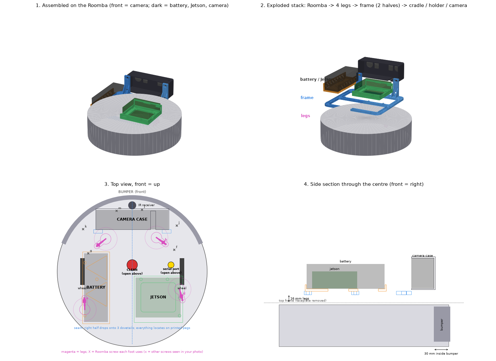

# 3D-printed platform

An open frame that sits on top of the Roomba 550 and carries the robot's electronics:

- **MYNT EYE D1000-IR-120** stereo camera at the front, on two posts on the frame, with a shroud
- **Jetson Orin Nano Super developer kit** at the rear right, in a screwless holder with its ports facing forward into the open middle
- **Battery cradle** on the left

Everything fits together without tools. The only screws are the camera's own **M4×12** case screws, which go
from behind through the camera posts. Four legs replace four of the Roomba's top-cover screws and use the
existing screw holes, so nothing is drilled. The middle stays open, so the **CLEAN** button can be pressed and
the **Mini-DIN serial port** stays reachable. Every part fits a **229 × 208 mm** print bed.

> **Note:** the battery cradle was designed around an **Anker 737 power bank**. The robot now runs from a
> Ridgid 18 V pack and a 15 V regulator (see [`docs/system-wiring.png`](../../docs/system-wiring.png)),
> so the cradle may need adapting.



## Parts

| File | Print | Notes |
|---|---|---|
| `frame_left.stl` | 1 | Left half of the frame. The halves join with vertical dovetails; the camera plate screws to two posts on the frame. |
| `frame_right.stl` | 1 | Right half of the frame |
| `leg_h16.stl` | **4** | 16 mm legs (`LEG_HEIGHTS` in `roomba_platform.py`). The frame drops onto pegs on the leg tops. |
| `battery_cradle.stl` | 1 | Presses onto pegs on the frame |
| `jetson_holder.stl` | 1 | Presses onto pegs on the frame |
| `camera_shroud.stl` | 1 | |

The pegs are part of the legs and the frame, so there are no separate pins to print.
The STLs are already in print orientation.

### Fit tests (`fit_tests/`)

Print these small pieces first to check your printer's tolerances before the large parts:

| File | Checks |
|---|---|
| `peg_fit_test.stl` | Peg press fit in its holes |
| `dovetail_fit_test.stl` | One dovetail joint between the frame halves |
| `jetson_port_wall_fit_test.stl` | Slice of the Jetson holder's port wall: check the developer kit's ports line up |
| `camera_shroud_fit_test.stl` | Front slice of the camera shroud: check it fits the camera |

## Suggested print order

1. Fit tests. If anything is too tight or loose, adjust the clearances in `roomba_platform.py` and regenerate.
2. Four legs. Fit them to the Roomba's top-cover screw holes.
3. `frame_left.stl` and `frame_right.stl`.
4. Jetson holder, camera shroud and battery cradle.

## Regenerating the parts

The parts are generated by `roomba_platform.py` (manifold3d + trimesh). `render_assembly.py` draws
`assembly_on_roomba.png`.

```bash
python -m venv .venv
source .venv/bin/activate          # Windows: .venv\Scripts\activate
pip install -r requirements.txt
python roomba_platform.py          # prints clearance checks, writes the STLs
python render_assembly.py          # writes assembly_on_roomba.png
```

Both scripts write their output next to themselves, in this folder. The fit-test STLs are also written
here; move them into `fit_tests/` if you commit them. Measurements and settings are at the top of
`roomba_platform.py`.
